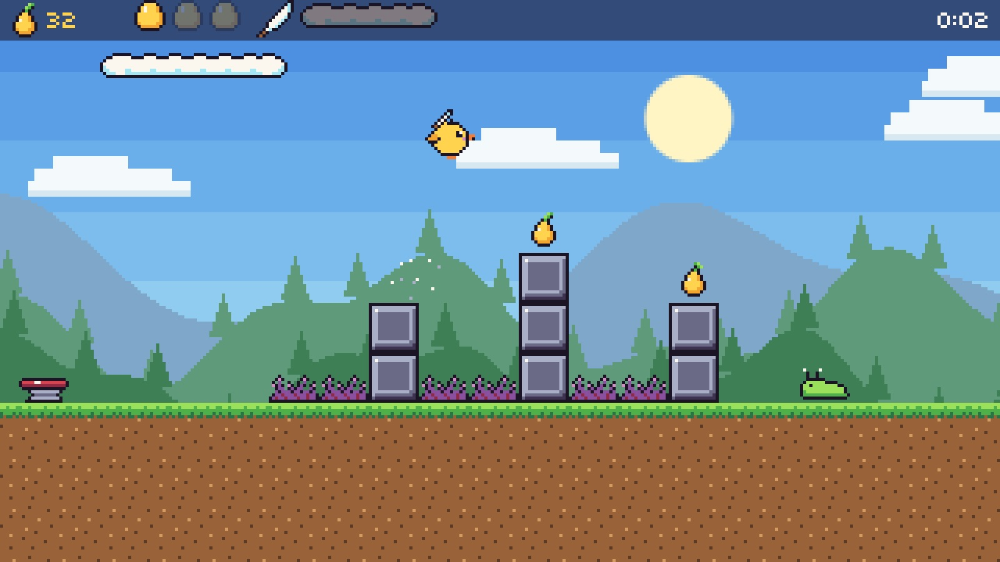
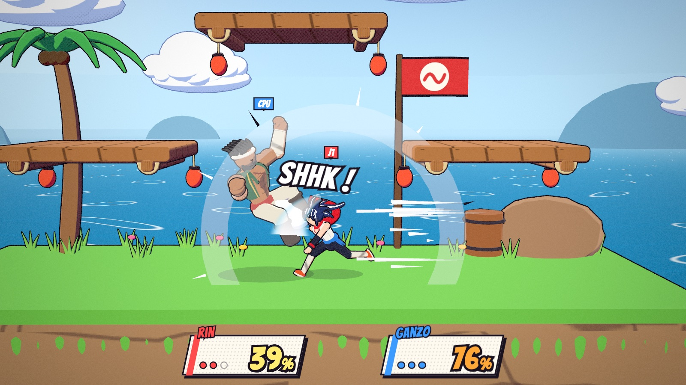
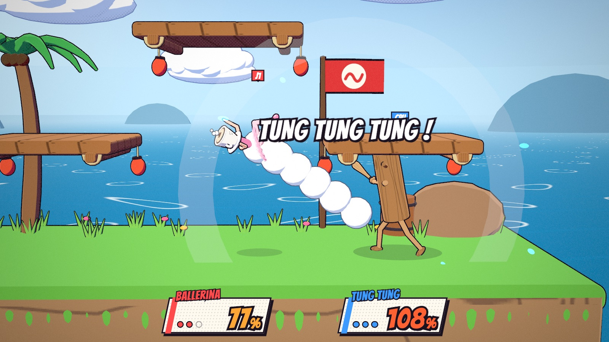
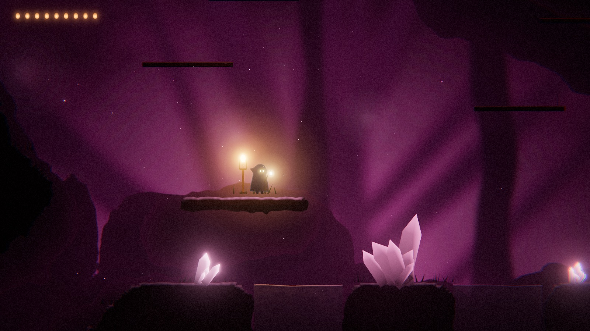
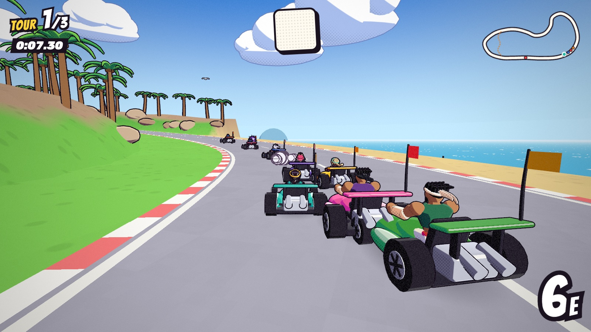
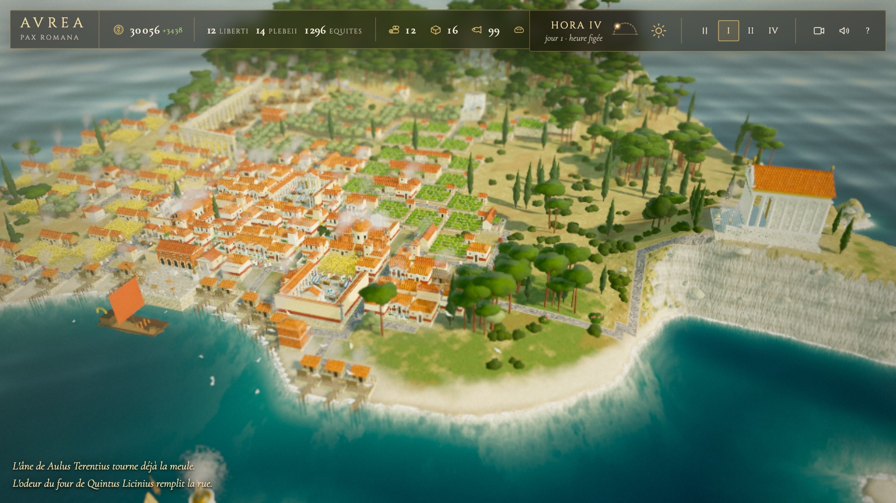
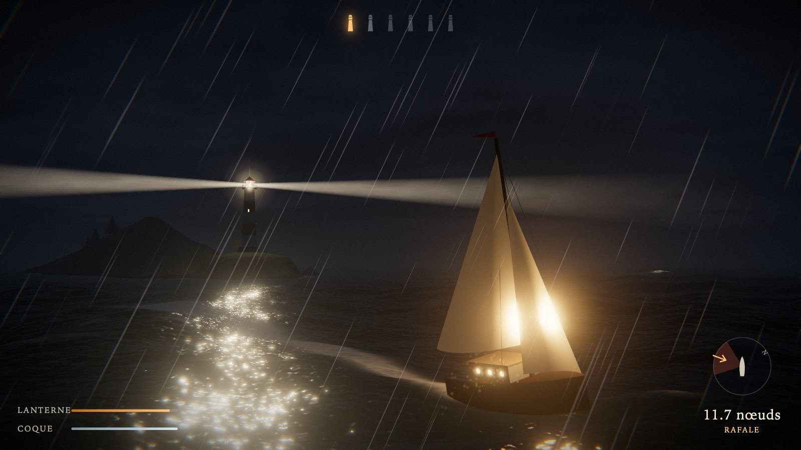
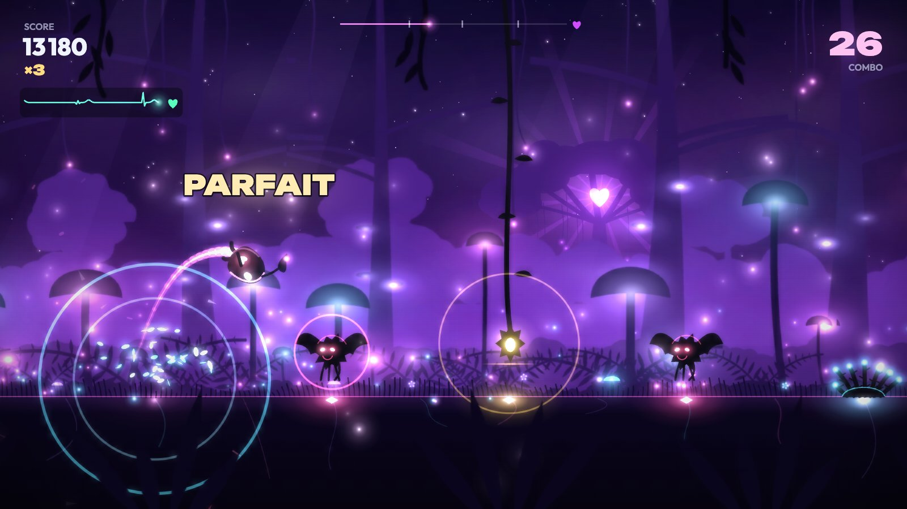
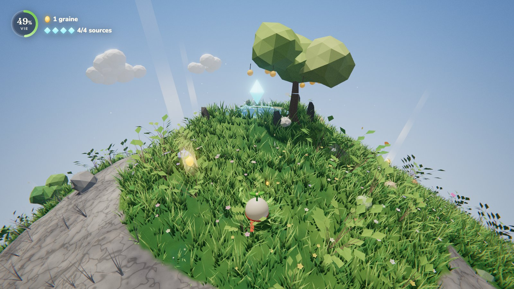

# Prototypes de jeux

Neuf prototypes de jeux jouables dans le navigateur, écrits en TypeScript (Canvas 2D ou Three.js) et construits avec Vite. Aucun fichier image ni son : tout est dessiné et composé en code.

<table>
  <tr>
    <td width="33%" align="center"><a href="plume/"></a><br><b><a href="plume/">Plume</a></b><br><sub>plateformer en pixel art</sub></td>
    <td width="33%" align="center"><a href="clash-au-recif/"></a><br><b><a href="clash-au-recif/">Clash au Récif</a></b><br><sub>versus fighting 3D, rendu manga</sub></td>
    <td width="33%" align="center"><a href="brainrot-clash/"></a><br><b><a href="brainrot-clash/">Brainrot Clash</a></b><br><sub>Clash au Récif version brainrot</sub></td>
  </tr>
  <tr>
    <td width="33%" align="center"><a href="veilleuse/"></a><br><b><a href="veilleuse/">Veilleuse</a></b><br><sub>traversée contemplative 2D</sub></td>
    <td width="33%" align="center"><a href="rallye-du-recif/"></a><br><b><a href="rallye-du-recif/">Rallye du Récif</a></b><br><sub>course de karts 3D</sub></td>
    <td width="33%" align="center"><a href="aurea/"></a><br><b><a href="aurea/">Aurea</a></b><br><sub>city builder romain 3D</sub></td>
  </tr>
  <tr>
    <td width="33%" align="center"><a href="phares/"></a><br><b><a href="phares/">Phares</a></b><br><sub>voilier dans la tempête</sub></td>
    <td width="33%" align="center"><a href="pouls/"></a><br><b><a href="pouls/">Pouls</a></b><br><sub>rythme-action 2D</sub></td>
    <td width="33%" align="center"><a href="germe/"></a><br><b><a href="germe/">Germe</a></b><br><sub>faire revivre une petite planète</sub></td>
  </tr>
</table>

## Lancer un jeu

Il faut [Bun](https://bun.sh).

```bash
cd plume
bun install
bun dev
```

Puis ouvrir l'adresse affichée (Chrome de préférence, avec le son). Chaque dossier a son propre README avec les commandes et les choix du jeu.

## Licence

[MIT](LICENSE)
