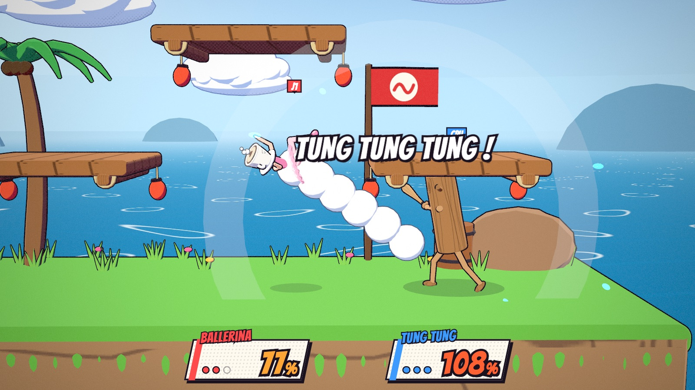

# Brainrot Clash — prototype 4



Le prototype 3 (« Clash au Récif »), avec deux brainrots à la place des persos manga :
**Ballerina Cappuccina**, danseuse rapide et légère à tête de tasse de cappuccino, et
**Tung Tung Tung Sahur**, une bûche lente et lourde armée d'une batte. Même moteur, même
arène, même bot (3 niveaux), même rendu cel shading en Three.js.

## Lancer

```bash
bun install
bun dev     # http://localhost:5176
bun test    # la simulation et le bot (moins d'une seconde)
```

Raccourcis de mise au point : `?direct=ballerina,tung,difficile` lance un combat tout de suite
(`?direct=ballerina,tung,2j` à deux), `&bots` fait jouer deux bots, `&vies=1` raccourcit le combat.
`atelier.html?perso=tung&poses=garde,coup:batte:11` montre un perso dans des poses.

## Commandes

| | Seul contre le bot | J1 (à deux) | J2 (à deux) |
|---|---|---|---|
| Bouger | ZQSD ou flèches | ZQSD | flèches |
| Sauter (2 fois en l'air pour Ballerina, 1 pour Tung) | Z, ↑ ou Espace | Z | ↑ |
| Attaque | J | F | K (ou 1 du pavé) |
| Spécial | K | G | L (ou 2) |
| Garde | L ou Maj | H | M (ou 3) |

↓ descend d'une plateforme, ou fait tomber plus vite en l'air. Échap met en pause, M coupe
le son. Une manette marche aussi (A sauter, X attaque, B spécial, gâchettes garde).

## Les règles

Comme dans Smash : chaque coup ajoute des **pourcentages de dégâts**, et plus ils montent, plus
on est **éjecté loin**. On perd une vie en sortant de l'écran (souvent dans la mer). Trois vies
chacun. La **garde** bloque tout mais s'use, et casse si on la garde trop : on reste alors sonné.

- **Ballerina Cappuccina** : deux grands battements puis une pirouette (appuyer trois fois),
  un tourbillon en l'air, et le **fouetté**, une ruée en tournoyant (en l'air, elle fait
  aussi remonter).
- **Tung Tung Tung Sahur** : un coup de batte qui **encaisse** les coups pendant qu'il arme,
  la batte abattue vers le bas en l'air, et le **tung tung tung** qu'on charge en gardant le
  bouton (il casse les gardes ; en l'air, il fait remonter).

## Les choix

- **La simulation ne dépend pas du rendu** (`src/combat/`). Elle avance d'une image à la fois
  (60 par seconde), toujours de la même façon : elle tourne aussi dans les tests.
- **Le bot joue avec les mêmes commandes qu'un joueur** (`src/combat/bot.ts`). Il voit les
  attaques après un temps de réaction (24, 13 ou 7 images selon le niveau), se met en garde,
  frappe à portée, guette au bord, et sait revenir sur le récif.
- **Tout est fait maison, sans aucun fichier d'image ni de son.** Les persos sont des formes
  simples sur un squelette, animés par des poses écrites en angles (`src/rendu/persos/`) :
  une tasse et sa soucoupe, un tutu festonné, une bûche veinée, une batte. Les visages, le
  cœur dans la mousse et le bois sont peints en code. La batte existe dans les deux mains :
  seule celle côté caméra se voit, pour que le coup reste lisible dans les deux sens.
- **Les deux persos reprennent exactement les réglages de Rin et Ganzo** (prototype 3) : seuls
  les noms, les modèles, les animations, les sons (le « tung » du bois) et les onomatopées
  changent. L'équilibre et les tests sont donc les mêmes.
- **Le style manga** (`src/rendu/toon.ts`, `src/rendu/scene.ts`) : ombres franches, trame de
  points dans les ombres, contours encrés, lignes de vitesse, onomatopées, et un « cadre
  d'impact » en noir et blanc inversé sur les gros coups.

## Ce que vérifient les tests

`bun test` joue des combats entiers sans navigateur :
- sauts, plateformes, enchaînement, garde, éjection plus forte quand les dégâts montent ;
- le bot revient sur le récif depuis presque toutes les positions ;
- il bat un joueur immobile sans tomber tout seul, avec chaque perso ;
- entre deux bots, le combat se termine, presque sans chute « toute seule » ;
- le niveau difficile bat le niveau facile au moins 8 fois sur 10.

`bun tests/diagnostic.ts` affiche des statistiques d'équilibre (qui gagne, à quel pourcentage
on est éjecté).

## Ce qu'on peut modifier à la main

| Fichier | Ce qu'il contient |
|---|---|
| `src/combat/persos.ts` | vitesses, sauts, poids, et chaque coup (dégâts, portée, éjection, images) |
| `src/combat/arene.ts` | le récif, les plateformes, les limites de l'écran |
| `src/combat/bot.ts` | les niveaux du bot (réaction, garde, agressivité) |
| `src/rendu/persos/*-poses.ts` | les poses et les animations des coups |
| `src/rendu/persos/ballerina.ts`, `tung.ts` | l'apparence et les couleurs |

Après un changement de réglage, `bun test` dit si le bot sait encore jouer et revenir.

## Ce qui reste à juger en jouant

Les sensations à la manette ou au clavier, et l'équilibre entre humains : il n'a été mesuré
qu'entre bots (Ballerina gagne 10 à 15 combats sur 20 selon le niveau).
