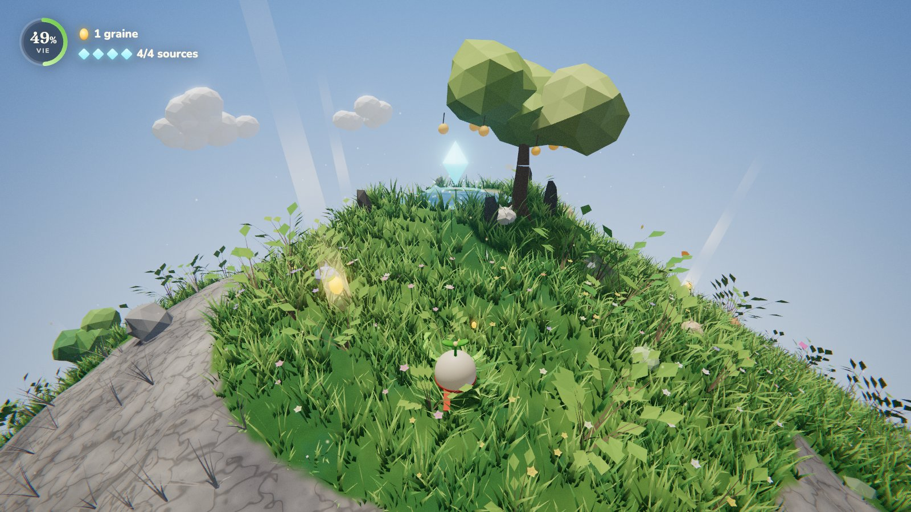

# Germe — prototype 12



Une toute petite planète, morte et grise. On y joue un petit être au galet crème, une pousse sur la tête,
une écharpe corail. On marche tout autour de la sphère (la gravité tire vers le centre) pour la faire revivre :
pousser la pierre qui bouche la première source, ramasser les graines lumineuses, les planter dans la terre
humide, creuser des rigoles pour mener l'eau, réveiller les sources endormies. L'herbe gagne de proche en proche,
les arbres poussent, les fleurs s'ouvrent, puis viennent les pelotes, les papillons et les oiseaux.
Des vents de cendre ré-assèchent la vie que les arbres et l'eau ne protègent pas ; les nuits froides gèlent
l'herbe isolée. À 85 % de planète vivante, une vague verte fait le tour du monde et la caméra s'envole.
Une partie dure une dizaine de minutes. Univers original.

## Lancer

```bash
cd germe && bun install && bun dev
```

Puis ouvrir http://localhost:5412 (Chrome de préférence, avec le son). `bun run build` produit la version statique.
Aucun fichier image ni son : tout est dessiné et synthétisé en code (Three.js, Web Audio).

| Paramètre d'URL | Effet |
|---|---|
| `?direct` | saute l'écran titre |
| `?vite=8` | la vie (herbe, arbres) pousse 8 fois plus vite |
| `?vie=0.6` | planète déjà vivante à 60 % |
| `?graines=20` | graines en poche au départ |
| `?heure=0.9` | heure de départ (0 minuit, 0,5 midi) |
| `?cendre=10` | premier vent de cendre au bout de 10 s |
| `?fin` | montre la séquence de fin |
| `?muet`, `?fps` | sans le son ; affiche le temps par image |

## Touches

ZQSD / WASD (ou flèches) marcher · Maj courir · Espace sauter · E ou clic planter (ou offrir une graine à une
source endormie) · F ou clic droit creuser (en marchant : une rigole) · C souffle (chasse la cendre, fait pousser
autour de soi) · souris regarder (clic pour la capturer, molette pour la distance) · M couper le son.

## Choix

- **Tout vit sur les sommets d'un icosaèdre subdivisé** (`src/monde/`) : 40 962 sommets, environ 30 cm entre deux.
  Chaque sommet a sa hauteur de sol, son eau, son humidité, sa vie, sa cendre. La simulation ne connaît pas Three.js.
- **L'eau coule vraiment** (`src/monde/monde.ts`) : chaque sommet mouillé verse vers ses voisins plus bas. Creuser
  abaisse le sol, une pierre le relève : c'est ainsi qu'on guide l'eau. Les sources montent jusqu'à un niveau, comme
  un puits artésien, ce qui permet à la première de rester sagement dans sa cuvette tant que la pierre la bouche.
- **L'humidité est un champ de distance** à l'eau et aux arbres ; l'herbe ne pousse que sur sol humide et
  à côté d'herbe déjà là. Les arbres adultes sèment seuls, la planète s'emballe vers la fin.
- **Le rendu lit l'état dans deux textures** (`src/rendu/communs.ts`) : le sol (gris craquelé → brun humide → vert),
  l'eau (un second maillage posé sur le sol par le shader), l'herbe (70 000 touffes instanciées, couchées tant que
  le sommet est mort), les fleurs, les buissons morts qui reverdissent : tout ce petit monde est posé et animé
  par les shaders, sans rien coûter au processeur.
- **Les arbres sont construits par programme** (`src/rendu/arbres.ts`) : quatre espèces, branches et feuillage à
  facettes, croissance avec rebonds ; ce qui passe entre la caméra et le petit être s'efface en pointillé.
- **Le jour tourne autour de la planète** (`src/jeu/cycle.ts`) : marcher vers l'est avance l'heure.
- **La musique s'enrichit avec la vie** (`src/son/musique.ts`) : bourdon et cloches lointaines sur la planète morte,
  puis nappe, arpèges, basse, mélodie, percussions et chœur à mesure que la vie revient.
- **Réglages** : tout le gameplay est dans `src/reglages.ts`.

## Vérifier

Les scripts de `.verif/` : `bun .verif/partie-auto.ts` joue une partie sans rendu avec un petit robot (victoire
en 6 min 15 environ ; un humain met plutôt 9 à 11 min) ; `bun .verif/capture.ts <nom> "<paramètres>"` prend une
capture avec le Chromium de Playwright (serveur lancé sur le port 5412) ; `bun .verif/fumee.ts` fait jouer une minute
au hasard et relève les erreurs de la console.
