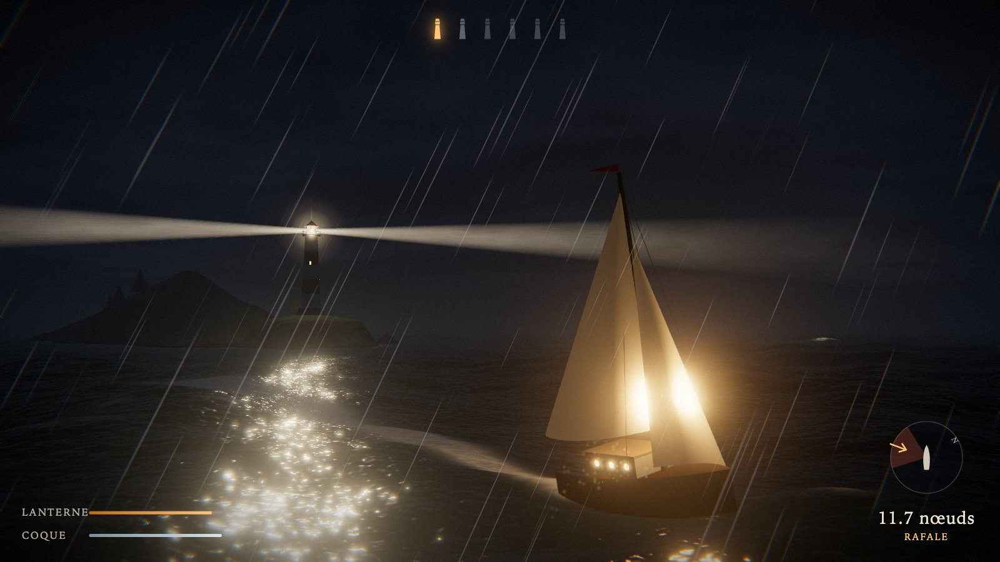

# Phares — prototype 10



De nuit, en pleine tempête, on barre L'Étincelle, un petit voilier, entre les récifs d'un archipel pour
rallumer un à un cinq phares éteints. Chaque feu rallumé calme la mer autour de lui, refait le plein
d'huile de la lanterne et répare la coque. Quand les six feux brûlent, la tempête se retire et le jour se lève.
Univers original. Une partie dure de 5 à 10 minutes.

## Lancer

```bash
cd phares && bun install && bun dev
```

Puis ouvrir http://localhost:5410 (Chrome de préférence, son activé). Aucun fichier image ni son :
l'océan, le ciel, les îles, le bateau et toute la bande-son sont générés en code. `bun run build` produit
une version statique dans `dist/`.

| Paramètre d'URL | Effet |
|---|---|
| `?direct` | saute l'écran titre |
| `?auto` | pilote automatique : il joue la partie jusqu'au bout |
| `?invincible`, `?fantome` | pas de dégâts / le bateau traverse récifs et îles |
| `?phares=3` | les 3 premiers phares sont déjà rallumés (on part du dernier) |
| `?x=-150&z=360&cap=-65` | position et cap de départ (cap en degrés, 0 = nord) |
| `?vue=phare` \| `haut` \| `cote` | caméra fixe pour les captures |
| `?q=0.5` | résolution de rendu forcée (sinon elle s'adapte toute seule) |
| `?debug` | affiche l'état de la simulation |

## Touches

← → (ou Q/D en AZERTY, A/D en QWERTY) barrer · ↑ ↓ (ou Z/S) hisser et affaler la voile ·
C change de caméra · M coupe le son · P ou Échap met en pause · Entrée commence et recommence.

On ne peut pas remonter face au vent : la boussole en bas à droite montre d'où il vient et la zone
interdite en rouge. Pour aller contre le vent, on tire des bords en zigzag. Pour rallumer un phare, il suffit
d'approcher de son pied.

## Choix

- **Three.js + shaders maison** : l'océan (`src/rendu/ocean.ts`) est une grille dense près de la caméra,
  déformée par huit vagues de Gerstner. La même houle est recalculée sur le CPU (`src/monde/vagues.ts`) pour
  faire flotter, tanguer et dériver le bateau. Le shader ajoute des rides, des impacts de pluie, l'écume des
  crêtes, du rivage et du sillage, les reflets de la lanterne, des lampes et d'une lune voilée.
- **Les phares** (`src/rendu/phare.ts`) : deux cônes additifs pour le faisceau volumétrique, plus le même
  faisceau projeté sur l'eau dans le shader de l'océan, masqué par le relief. Un projecteur éclaire les îles
  au passage. Quand le pinceau regarde la caméra, un halo d'éblouissement prend le relais.
- **Le relief** (`src/monde/archipel.ts`) est une fonction `hauteurTerrain(x, z)` : elle sert au dessin des
  îles et des récifs, aux collisions et, cuite dans une texture, à l'écume du rivage.
- **La navigation** (`src/jeu/navigation.ts`) : la vitesse dépend de l'angle au vent (vent debout, travers,
  vent arrière), le vent tourne lentement et souffle par rafales, et les vagues poussent le bateau.
- **Le son** (`src/audio/son.ts`) : vent, sifflement du gréement, pluie, mer, tonnerre retardé selon la
  distance de l'éclair, grincements du bois, chocs, cloches des phares et musique d'ambiance générative
  (ré mineur la nuit, ré majeur à l'aube), le tout avec la Web Audio API.
- **Les réglages de jeu** (vitesse, vent, huile, coque, phares) sont regroupés dans `src/reglages.ts`.
- **Vérification** : `.verif/` contient les scripts Playwright (captures, partie complète au pilote
  automatique) et les captures d'écran. Dans la console, `jeu.avancer(30)` simule 30 secondes d'un coup.
