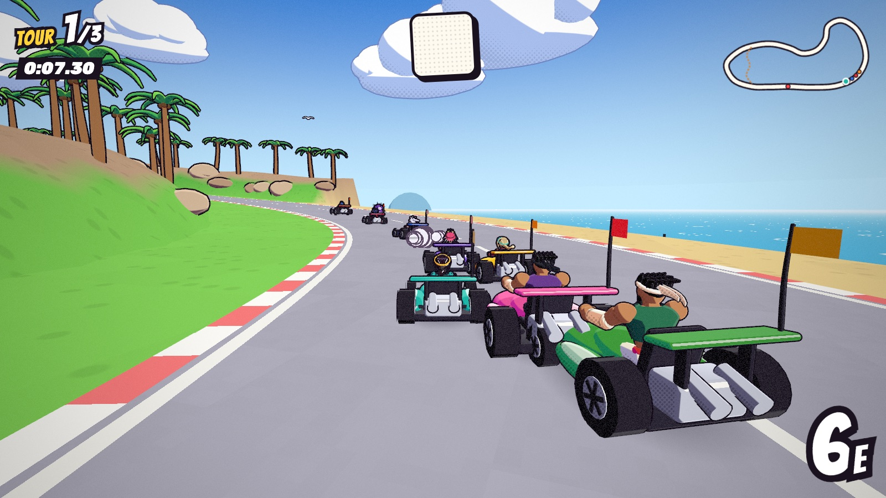

# Rallye du Récif — prototype 6



Une course de karts dans l'esprit de Mario Kart, en 3D avec un rendu manga (Three.js, cel shading).
Huit karts font trois tours d'une île tropicale : une ligne droite sur la plage, une montée vers le
phare, une épingle, une descente avec un tremplin, un pont au-dessus de la passe et une grande anse,
qu'un ponton étroit permet de couper. On court seul contre sept bots, à trois niveaux.

## Lancer

```bash
bun install
bun dev     # http://localhost:5178
bun test    # le circuit, la conduite, les objets et les bots (environ une seconde)
```

Raccourcis de mise au point :

- `?direct=mira,difficile` lance une course tout de suite.
- `&bot` la fait conduire par un bot, `&avance=40` saute les 40 premières secondes, `&debug` écrit l'état dans la console.
- `?pilote` ouvre le choix du pilote.
- `atelier-kart.html` montre les quatre karts côte à côte, avec ces options : `?angle=2.6&braquage=0.5&turbo&bulle&variante`.
- `atelier-pilotes.html` montre les pilotes debout.

## Commandes

| | Clavier | Manette |
|---|---|---|
| Accélérer | ↑ ou Z | A ou gâchette droite |
| Freiner, reculer | ↓ ou S | B ou gâchette gauche |
| Tourner | ← → ou Q D | stick gauche |
| Sauter et déraper | Espace ou Maj (garder appuyé) | LB ou RB |
| Objet | E | X ou Y |

Échap met en pause, M coupe le son.

## Les règles

- **Le dérapage** : on saute en appuyant sur Espace avec une direction, et on garde appuyé. Les
  étincelles deviennent bleues, puis orange. En lâchant, on gagne un mini-turbo, plus long s'il
  était orange. Braquer vers l'intérieur charge plus vite et serre le virage ; braquer vers
  l'extérieur l'élargit. À pleine vitesse, on tourne mal sans déraper.
- **Le départ** : accélérer juste avant « PARTEZ ! » donne un turbo, pas trop tôt.
- **Les perles** : des perles nacrées entourées de cerceaux dorés. En passer une donne un objet au
  bout d'une seconde de roulette. Plus on est loin derrière, meilleurs sont les objets.
  - **Piment** : un turbo.
  - **Oursin** : il part tout droit et rebondit sur les bords de la route.
  - **Méduse** : elle se pose derrière soi et reste sur la piste.
  - **Bulle** : elle protège d'un coup.
- **Les sols** : l'herbe et le sable ralentissent, sauf en turbo. Les bandes d'accélération
  orange donnent un turbo.
- **L'eau** : on tombe à l'eau au bord des plages, de la lagune et du ponton. On est replacé sur
  la route un peu plus d'une seconde plus tard.
- **Le ponton** : il coupe la grande anse, mais il est étroit et sans rambarde.

## Les pilotes

| | Vitesse | Accélération | Virage | Poids | Particularité |
|---|---|---|---|---|---|
| **Rin**, la Bourrasque | − | ++ | ++ | léger | démarre en flèche |
| **Tao**, le Mécano | = | = | = | moyen | équilibré |
| **Mira**, la Plongeuse | = | + | + | léger | charge ses mini-turbos plus vite |
| **Ganzo**, le Roc | ++ | −− | − | lourd | personne ne le pousse |

Rin et Ganzo viennent de Clash au Récif (prototype 3). Chaque pilote existe en deux couleurs : le
second exemplaire est conduit par un bot.

## Les choix

- **La simulation ne dépend pas du rendu** (`src/course/`). Elle avance d'une image à la fois, à
  60 images par seconde, toujours de la même façon. C'est pour ça qu'elle tourne aussi dans les
  tests. Le rendu interpole entre deux images pour rester fluide sur les écrans à 120 Hz.
- **Le circuit est décrit par des points clés** (`src/course/circuit.ts`). Une courbe passe par
  ces points ; elle est échantillonnée tous les mètres.
  - Chaque point clé donne l'altitude, la largeur et les deux bas-côtés : du sable ou de l'herbe,
    jusqu'à un mur ou jusqu'à l'eau.
  - La 3D se construit à partir de ces données : la route, les bas-côtés, le relief, les fonds de
    la lagune, le pont et le ponton. Si on déplace un point, l'île suit.
- **Les bots jouent avec les mêmes commandes qu'un joueur** (`src/course/bot.ts`).
  - Ils visent un point devant eux sur la route : c'est la poursuite pure.
  - Ils coupent les virages, dérapent quand la courbe qui arrive est assez longue et se servent
    de leurs objets.
  - Selon le niveau, ils évitent les méduses et tentent le ponton.
- **Tout est fait maison, sans aucun fichier d'image ni de son.**
  - Les karts, les pilotes, les palmiers, le phare et le village sont des formes simples, encrées.
  - Le décor statique est fusionné en quelques maillages (`src/rendu/fusion.ts`).
  - La musique est une boucle de surf rock synthétisée.

## Ce que vérifient les tests

`bun test` fait courir des karts sans navigateur :

- **Le circuit** : il ne se chevauche pas, et les perles, les bandes et la grille sont sur la
  route. Le raccourci rejoint bien la route et fait gagner du chemin. On tombe à l'eau à côté du
  ponton, pas dessus.
- **La conduite** : la vitesse de pointe, le turbo de départ et le mini-turbo du dérapage. La
  rambarde du pont tient. Après une chute, on repart de la route. Les tours sont comptés.
- **Les objets** : l'oursin, la méduse, la bulle, le piment et la roulette des perles.
- **Les bots** :
  - Huit bots finissent la course avec les objets, sans rester coincés.
  - Chaque pilote finit seul sans tomber.
  - Le dérapage fait gagner plus d'1,5 s à chaque pilote, et le ponton fait gagner du temps.
  - Le niveau difficile bat le niveau facile au moins 8 fois sur 10.

`bun tests/diagnostic.ts` affiche les temps au tour de chaque pilote, à chaque niveau.

## Ce qu'on peut modifier à la main

| Fichier | Ce qu'il contient |
|---|---|
| `src/reglages.ts` | la vitesse, le braquage, le dérapage, les turbos, les objets, le nombre de tours |
| `src/course/pilotes.ts` | les quatre pilotes et leurs statistiques |
| `src/course/circuit.ts` | les points clés, le ponton, les perles, les bandes et le tremplin |
| `src/course/bot.ts` | les niveaux des bots |
| `src/rendu/pilotes.ts` | les couleurs des karts et des variantes |

Après un changement, `bun test` dit si le circuit tient debout et si les bots savent encore finir
la course.

## Ce qui reste à juger en jouant

- **Les sensations au clavier** : le dérapage, le braquage à pleine vitesse, le ponton.
- **La difficulté face à un humain** : les bots font le tour en 38 s environ en facile, 34 s en
  moyen et 31 s en difficile.
- **La fluidité sur une vraie carte graphique** : on compte environ 420 appels de dessin et
  600 000 triangles par image. Elle n'a été mesurée qu'en rendu logiciel.
